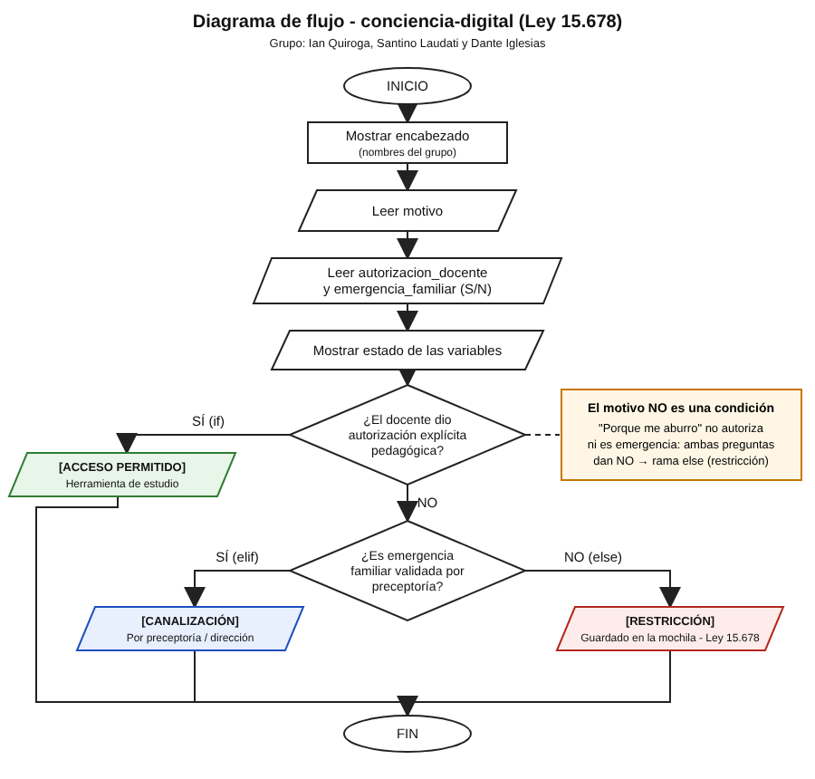

# Conciencia Digital – Actividad 10: Algoritmos y Marco Legal del Uso de Celulares en el Aula (Ley 15.678) (LPR 2026)

Simulador en **Python** del filtro de decisiones que aplica un docente o el sistema escolar para saber si un estudiante puede usar el celular en el aula, según la **Ley 15.678** de la Provincia de Buenos Aires. Se resuelve con un diagrama de flujo y una estructura `if` / `elif` / `else`.

**E.E.S.T. N.° 1 "Eduardo Ader" – Vicente López** · Laboratorio de Programación 5° 3° · Prof. Mansilla Muñoz York E.

## Integrantes

| Integrante | Rol |
|---|---|
| Ian Quiroga | Script `ley_celulares.py` y pruebas de las tres ramas |
| Santino Laudati | Informe APA v7, cuestionario y manual del programador |
| Dante Iglesias | Diagrama de flujo, capturas y repositorio |

## Lógica de decisión

| Condición | Rama | Salida |
|---|---|---|
| ¿El docente dio autorización explícita pedagógica? | `if` | `[ACCESO PERMITIDO]` – herramienta de estudio |
| ¿Es emergencia familiar validada por preceptoría? | `elif` | `[CANALIZACIÓN INSTITUCIONAL]` – preceptoría / dirección |
| Ninguna de las anteriores (ej. "porque me aburro") | `else` | `[RESTRICCIÓN LEY 15.678]` – celular guardado en la mochila |



## Ejecutar

```powershell
python src\ley_celulares.py
```

## Ejemplo

```
=> Motivo por el que quiere usar el celular: Porque me aburro
=> El docente habilito la actividad digital? (S/N): n
=> La emergencia fue validada por preceptoria? (S/N): n

[RESTRICCIÓN LEY 15.678] Tu celular debe permanecer guardado en la mochila.
```

## Documentación

- [Informe APA v7](docs/InformeEEST1_LPR2026_ACT10_Ley_Quiroga_v1.0.0.pdf)
- [Manual del programador (md)](docs/manuales/manual_programador_v1.0.0.md) · [pdf](docs/manuales/manual_programador_v1.0.0.pdf)
- Evidencias: `capturas/diagrama_flujo.png`, `capturas/ejecucion_acceso_permitido.png`, `capturas/ejecucion_canalizacion.png`, `capturas/ejecucion_restriccion.png`

Licencia MIT (uso escolar) – ver [LICENSE](LICENSE).
