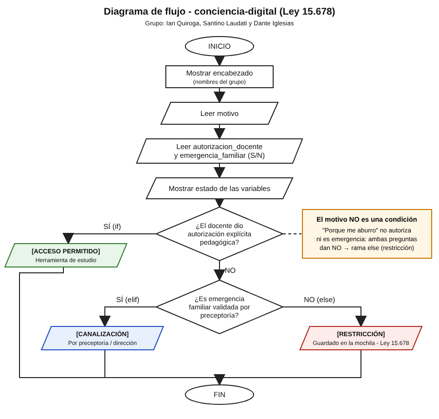
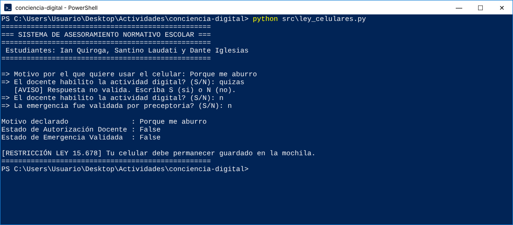

# 1. Propósito del documento

Este manual documenta el script **ley_celulares.py** del proyecto **conciencia-digital**. El programa simula el filtro de decisiones que aplica un docente o el sistema escolar para saber si un estudiante puede usar el celular en el aula, según la Ley 15.678 de la Provincia de Buenos Aires. Explica las variables, la estructura condicional, cómo ejecutarlo, las pruebas realizadas y cómo extenderlo.

# 2. Requisitos

| Herramienta | Versión |
|---|---|
| Python | 3.10 o superior |
| Visual Studio Code | Con extensión Python |
| Git | 2.x |
| Sistema operativo | Windows 10/11 |

# 3. Estructura del repositorio

```
conciencia-digital/
├── .gitignore  ├── .gitattributes  ├── LICENSE  ├── README.md
├── docs/InformeEEST1_LPR2026_ACT10_Ley_Quiroga_v1.0.0.pdf
├── docs/manuales/manual_programador_v1.0.0.(md|pdf)
├── src/ley_celulares.py
└── capturas/diagrama_flujo.png, ejecucion_*.png
```

# 4. Reglas de la Ley 15.678 modeladas

| Regla de la ley | Representación en el código |
|---|---|
| Regla general: no se usan celulares en clase | Rama `else` → `[RESTRICCIÓN LEY 15.678]` |
| Excepción pedagógica: autorización explícita del docente | `if autorizacion_docente == True` → `[ACCESO PERMITIDO]` |
| Emergencias familiares por preceptoría / dirección | `elif emergencia_familiar == True` → `[CANALIZACIÓN INSTITUCIONAL]` |
| Traer ≠ usar: el celular puede ir en la mochila | Mensaje de la rama `else` |



# 5. Referencia del código

## 5.1 Variables

| Variable | Tipo | Origen | Uso |
|---|---|---|---|
| `motivo` | `str` | `input()` | Se muestra en pantalla; **no** interviene en la decisión |
| `autorizacion_docente` | `bool` | `leer_si_no()` | Condición del `if` |
| `emergencia_familiar` | `bool` | `leer_si_no()` | Condición del `elif` |

## 5.2 `leer_si_no(pregunta)`

| Elemento | Detalle |
|---|---|
| Parámetro | `pregunta` – texto que se muestra al usuario |
| Acepta | `s`, `si`, `sí` → `True` · `n`, `no` → `False` (sin importar mayúsculas) |
| Entrada inválida | Muestra `[AVISO] Respuesta no valida...` y vuelve a preguntar |
| Retorno | `bool` |

## 5.3 Estructura de decisión

```python
if autorizacion_docente == True:
    print("[ACCESO PERMITIDO] ...")
elif emergencia_familiar == True:
    print("[CANALIZACIÓN INSTITUCIONAL] ...")
else:
    print("[RESTRICCIÓN LEY 15.678] ...")
```

El orden importa: con `elif`, apenas una condición es verdadera se ejecuta su bloque y las siguientes no se evalúan. Por eso la autorización docente tiene prioridad sobre la emergencia.

# 6. Ejecución

```powershell
python src\ley_celulares.py
```



# 7. Pruebas

| Motivo | Autorización | Emergencia | Salida esperada | Estado |
|---|---|---|---|---|
| Buscar documentación de Python | S | N | `[ACCESO PERMITIDO]` | OK |
| Llamar a mi casa por un familiar enfermo | N | S | `[CANALIZACIÓN INSTITUCIONAL]` | OK |
| Porque me aburro | N | N | `[RESTRICCIÓN LEY 15.678]` | OK |
| (cualquiera) | S | S | `[ACCESO PERMITIDO]` (prioridad del `if`) | OK |
| (cualquiera) | `quizas` | — | `[AVISO]` y se repite la pregunta | OK |

# 8. Guía de mantenimiento y extensión

- **Nueva excepción** (por ejemplo, un estudiante con necesidad de accesibilidad certificada): agregar una variable booleana, pedirla con `leer_si_no()` y sumar un nuevo `elif` **antes** del `else`. Actualizar la tabla 4 y el diagrama de flujo.
- **Simplificar las condiciones:** `if autorizacion_docente:` es equivalente a `if autorizacion_docente == True:`; se dejó la forma explícita por fines didácticos.
- **Registro de consultas:** para guardar un historial, abrir un archivo con `open("historial.txt", "a", encoding="utf-8")` y escribir el motivo y la decisión.
- Mantener los mensajes de salida sincronizados con el informe y con las capturas.
